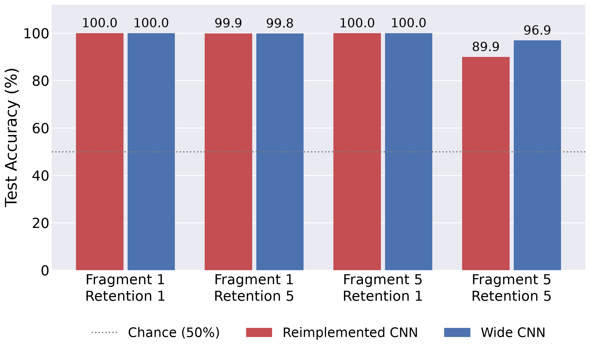
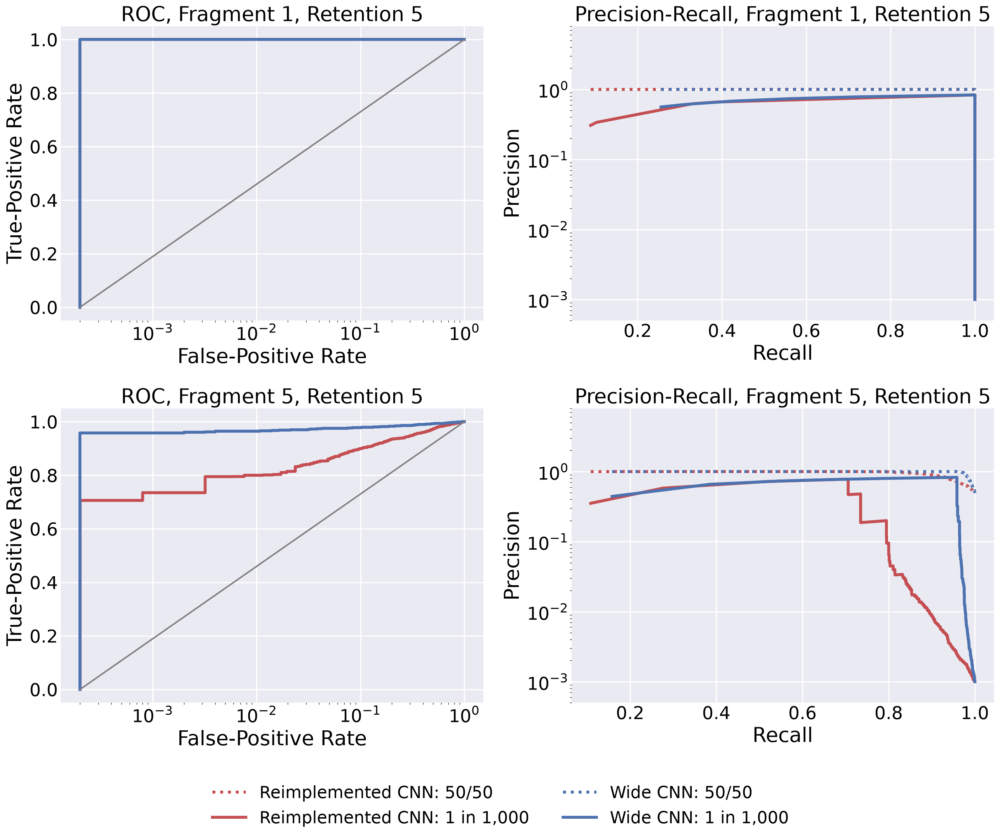
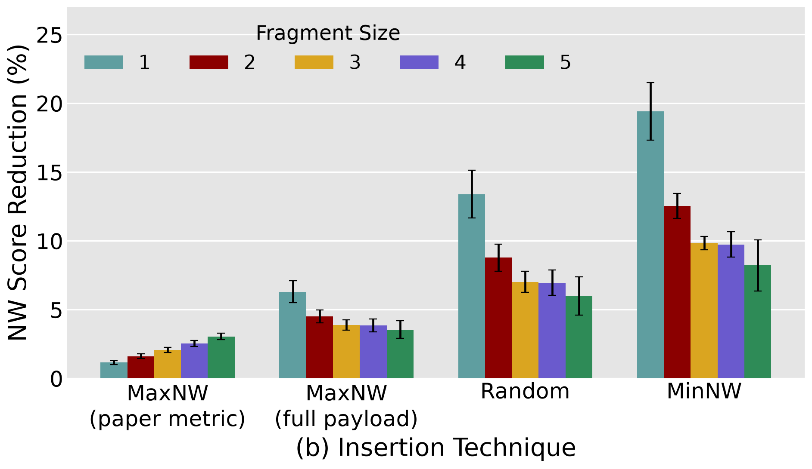
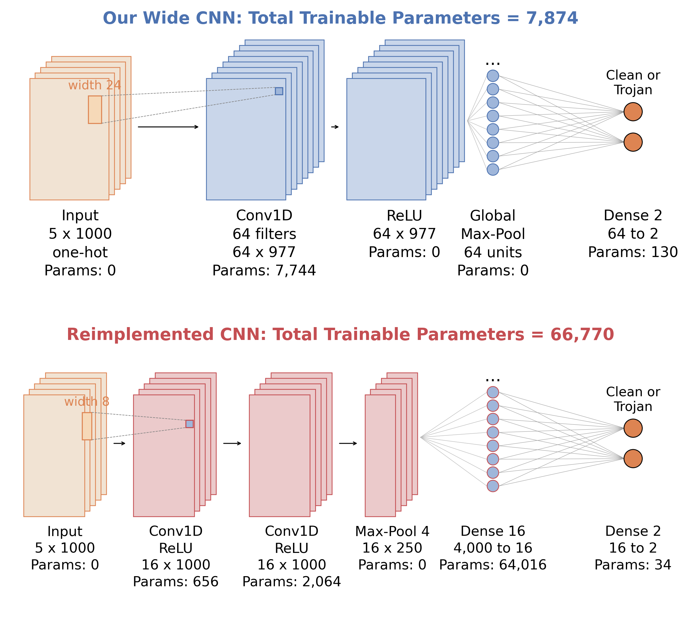
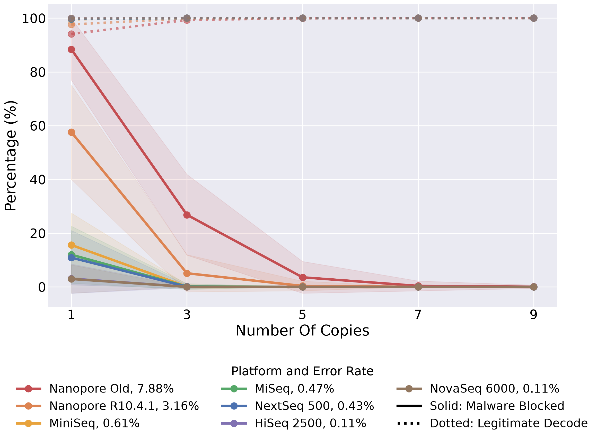

# Can a CNN Catch Trojan DNA?

Reimplementation and extension of *Using deep learning to detect digitally encoded DNA trigger for Trojan malware in Bio-Cyber attacks* (Islam et al., Scientific Reports, 2022).

Course project for CSCE 458/858 Molecular Communication, University of Nebraska–Lincoln. Author: Apala Pramanik.

> **Status.** The results below are preliminary. They come from one random seed, one insertion strategy (MaxNW) and one encryption key (0).

## What this project does

In a *Bio-Cyber attack*, an attacker hides a Trojan trigger, such as an IP address and port, inside synthetic DNA. A sequencing service reads the sample, and a Trojan in its software decodes the trigger and calls home. The original paper proposes a CNN that screens DNA reads before the pipeline processes them.

We rebuild the attack and the detector and ask three questions.

1. **Reproduce.** Do the alignment results of the paper reproduce?
2. **Re-test.** Does a CNN built as the paper describes reach its near perfect accuracy?
3. **Stress.** What happens to precision when a Trojan read is rare, a case the paper does not test?

We then propose a **Wide CNN** with global max pooling, and a **second defense** that limits how many amplified copies of a read a sequencer uses.

## Main results

All detector numbers use the setup of the paper: ten pooled datasets (10,000 clean and 10,000 Trojan reads), a random 75/25 read level split, SGD, early stopping, and at most 1,000 epochs.

**Test accuracy (%).** *Fragment* is the payload fragment size. *Retention* counts the host bases kept around each fragment.

| Fragment | Retention | Reimplemented CNN | Wide CNN |
|---|---|---|---|
| 1 | 1 | 100.0 | 100.0 |
| 1 | 5 | 99.9 | 99.8 |
| 5 | 1 | 100.0 | 100.0 |
| 5 | 5 | **89.9** | **96.9** |

At fragment size 5 and retention 5 the paper reports roughly 56%. We obtain 89.9% and do not know the reason for the difference.

**Rare attacks (fragment 5, retention 5).** Precision at one Trojan per 1,000 reads and 90% recall.

| | Reimplemented CNN | Wide CNN |
|---|---|---|
| Area under the ROC curve | 0.958 | 0.990 |
| False positive rate at 90% recall | 10.3% | 0 of 2,500 clean test reads |
| Precision at 1 Trojan per 1,000 reads | about 0.9% | high, but not measurable exactly |

The test set has 2,500 clean reads, so false positive rates below about 0.04% cannot be resolved. For the Wide CNN this gives a lower bound on precision of roughly 70%, not an exact value.

**Parameters.** The Reimplemented CNN has 66,770 trainable parameters. The Wide CNN has 7,874.

<p align="center">
  
</p>

<p align="center">
  
</p>

### Alignment results reproduce

The drop in alignment score for the Random and MinNW strategies follows the paper. For MaxNW the authors' code scores only the first fragment. When we score the finished read, the trend that larger fragments cost more similarity disappears. The trend in the paper therefore comes from the metric and not from the insertion. Data: `results/fig5b.json` and `results/fig6.json`.

<p align="center">
  
</p>

### The two models

<p align="center">
  
</p>

### Second defense: capping amplified copies

A sequencer amplifies a sample into copies and takes a majority vote at every position. We simulate seven sequencing platforms (error rates from 0.109% to 7.88%) and cap the number of copies. The cap blocks the hidden trigger only on noisy platforms and only at one copy. An attacker who submits redundant copies defeats it. We therefore propose to apply the cap only to reads that a detector flags.

<p align="center">
  
</p>

## Original paper and resources

**Paper.** Islam, M. S., Ivanov, S., Awan, H., Drohan, J., Balasubramaniam, S., Coffey, L., Kidambi, S. and Sri-saan, W. *Using deep learning to detect digitally encoded DNA trigger for Trojan malware in Bio-Cyber attacks.* Scientific Reports 12, 9631 (2022). https://doi.org/10.1038/s41598-022-13700-5

```bibtex
@article{islam2022,
  author  = {Islam, M. S. and Ivanov, S. and Awan, H. and Drohan, J. and Balasubramaniam, S. and Coffey, L. and Kidambi, S. and Sri-saan, W.},
  title   = {Using deep learning to detect digitally encoded {DNA} trigger for {Trojan} malware in {Bio-Cyber} attacks},
  journal = {Scientific Reports},
  volume  = {12},
  pages   = {9631},
  year    = {2022},
  doi     = {10.1038/s41598-022-13700-5}
}
```

**Authors' code.** https://github.com/sibleeislam/trojan-malware-in-bio-cyber-attacks. It holds the Addgene data collection scripts, the attack and dataset generation code, and their Keras CNN.

**Dataset.** The paper uses 716 *E. coli* plasmid DNAs from Addgene (https://www.addgene.org/). The collected sequences are in `addgene_data_collection/all_plasmid_dna.txt` of the authors' repository. Example payloads: https://bitbucket.org/sibleeislam/bio-cyber-hacking. See [`data/README.md`](data/README.md) for how to recreate our datasets.

The paper is open access under CC BY 4.0. This repository does not redistribute the paper's figures or the authors' code.

## Repository layout

```
.
├── README.md
├── requirements.txt            main environment (PyTorch, scikit-learn, matplotlib)
├── requirements-authors.txt    environments for the authors' own code
├── src/                        all code, numbered in the order we worked
├── scripts/                    helpers to run the final detector experiments
├── results/                    numbers: JSON, TXT and NPZ (test scores for ROC and PR)
├── figures/                    final figures as PNG, PDF and SVG; extra/ holds more plots
├── matrices/                   PAM10 and PAM30 substitution matrices (NCBI)
├── data/                       README only; generated datasets are not tracked
├── docs/                       explanatory notes
├── paper/                      final paper (to be added)
├── models/                     trained weights (not tracked)
└── authors_repo/               clone of the authors' repository (not tracked)
```

### Code in `src/`

| Step | Files | What it does |
|---|---|---|
| 2 | `ap_step2_explore_data.py` | Look at the raw plasmid data |
| 3 | `ap_step3_encode.py` | Encode a payload as DNA: fragments, XOR key, 2 bit encoding, tags, retention |
| 4 | `ap_step4_score.py`, `ap_step4b_greedy.py` | Alignment score and MaxNW, Random and MinNW placement |
| 4c | `ap_step4c_plots.py` | Alignment results of the paper at full scale |
| 4d | `ap_step4d_generate_datasets.py` | Write the clean and injected datasets |
| 5 | `ap_step5_kmer_check.py`, `ap_step5_plots.py` | k-mer logistic regression baseline |
| 6 | `ap_step6_cnn.py`, `ap_step6_compare.py` | First PyTorch CNN experiments |
| 7, 8, 15 | `ap_step7_roc_pr.py`, `ap_step8_report_figs.py`, `ap_step15_*.py` | Earlier ROC and PR figures (superseded) |
| 9 | `ap_step9_test_authors_maxnw.py`, `ap_step9_authors_cnn.py` | Run the authors' own alignment and CNN code |
| 10, 14 | `ap_step10_consensus_tradeoff.py`, `ap_step14_full_dataset_boxplot.py` | Amplification and majority vote simulation |
| 16, 17 | `ap_step16_cnn_diagram.py`, `ap_step17_big_figs.py` | Architecture diagram; redraw figures with large fonts |
| **18** | `ap_step18_same_as_original.py` | **Final detectors**: Reimplemented CNN and Wide CNN on the paper's setup |
| **19, 20** | `ap_step19_accuracy_bars.py`, `ap_step20_roc_pr.py` | **Final accuracy bars and ROC and PR curves** |

The configuration file `src/ap_config.json` lists dataset facts and paths. Each script has a docstring that says what it does and how to run it.

## How to reproduce

```bash
# 1. Get the authors' code (needed for the raw data and the authors' alignment code)
git clone https://github.com/sibleeislam/trojan-malware-in-bio-cyber-attacks authors_repo

# 2. Create the environment
python3 -m venv .venv && source .venv/bin/activate
pip install -r requirements.txt

# 3. Generate the datasets (about 845 MB)
python3 src/ap_step4d_generate_datasets.py 1,5 1,5 0 0,1,2,3,4,5,6,7,8,9

# 4. Train and test both detectors: two models, fragment sizes 1 and 5, retention 1 and 5
DEVICE=cpu scripts/run_all_detectors.sh 2        # use DEVICE=mps on an Apple GPU, or cuda

# 5. Redraw the final figures
python3 src/ap_step19_accuracy_bars.py
python3 src/ap_step20_roc_pr.py
python3 src/ap_step16_cnn_diagram.py
```

On an Apple GPU, one detector run took from about 10 minutes to over an hour, depending on how many jobs shared the GPU. We have not re-run the full pipeline from a clean clone, so expect small path fixes.

## Limitations

- One seed, one insertion strategy (MaxNW), one encryption key, and only fragment sizes 1 and 5 at retention 1 and 5.
- The test set holds 2,500 clean reads, so false positive rates below about 0.04% are not measurable.
- The paper reuses the same 1,000 host reads in every dataset, so test reads come from hosts seen in training. We follow this setup. Generalization to unseen hosts is not tested yet.
- Our early stopping rule is our own (the paper does not state one): stop after 100 epochs without a gain in validation loss, not before epoch 500, with at most 1,000 epochs. The paper trains for up to 3,000 epochs.
- The paper's value of roughly 56% is our approximate reading of its results.
- The Wide CNN is our own model, not the authors'.

## Acknowledgements

We thank the authors of the original paper for publishing their code and their data collection scripts. We also thank Addgene for the plasmid sequences.

Special thanks to **Dr. Sasitharan Balasubramaniam**, a co-author of the original paper, who taught this course and helped shape the ideas in this project.
